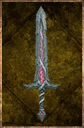

# Ancient Calygrey Greatsword

<!-- illustration -->
{ .equipment-portrait }
<!-- /illustration -->

**Catégorie :** Grandes épées  
**Famille :** Ancient Calygrey  
**Origine :** Créé pour le JDR

| Caractéristique | Valeur |
| --- | --- |
| Poids (kg) | 3 |
| Volume (L) | 5 |
| Taille | Moyenne |
| Achat (argent) | 1000 |
| Vente (argent) | 300 |
| Attaque | 14 |
| Touches | 4 |
| Dégâts de base | 140 |
| Modificateur de dégâts 1 | DEX |
| Modificateur de dégâts 2 | FOR |
| Modificateur de dégâts 3 | DEX |
| Parade | 8 |
| Réduction de base | 10 |
| Modificateur de réduction 1 | DEX |
| Modificateur de réduction 2 | FOR |
| DEX requise | 20 |
| FOR requise | 10 |
| Physique (%) | 90,0 |
| Feu (%) | 0,0 |
| Froid (%) | 0,0 |
| Foudre (%) | 10,0 |
| Décomposition (%) | 0,0 |
| Éthéré (%) | 0,0 |

## Propriétés

Bonus de dégâts froid : +20 %
Bonus de dégâts éclair : +20 %
Coût de mana : -20 %

[Retour au catalogue](../equipement.md)
