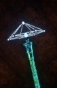

# Astral Greatmace

<!-- illustration -->
{ .equipment-portrait }
<!-- /illustration -->

**Catégorie :** Grands marteaux  
**Famille :** Astral  
**Origine :** Outward

Inflicts Doomed and Haunted.

| Caractéristique | Valeur |
| --- | --- |
| Poids (kg) | 3 |
| Volume (L) | 8 |
| Taille | Moyenne |
| Achat (argent) | 2500 |
| Vente (argent) | 750 |
| Attaque | 15 |
| Touches | 1 |
| Dégâts de base | 145 |
| Modificateur de dégâts 1 | FOR |
| Modificateur de dégâts 2 | FOR |
| Modificateur de dégâts 3 | FOR |
| Parade | 11 |
| Réduction de base | 25 |
| Modificateur de réduction 1 | FOR |
| Modificateur de réduction 2 | FOR |
| DEX requise | — |
| FOR requise | 30 |
| Physique (%) | 80,0 |
| Feu (%) | 0,0 |
| Froid (%) | 0,0 |
| Foudre (%) | 0,0 |
| Décomposition (%) | 20,0 |
| Éthéré (%) | 0,0 |

## Propriétés

Doomed / Accumulation 33%
Haunted / Accumulation 33%
Bonus de dégâts feu : +7 %
Bonus de dégâts froid : +7 %

[Retour au catalogue](../equipement.md)
