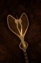

# Damascene Hammer

<!-- illustration -->
{ .equipment-portrait }
<!-- /illustration -->

**Catégorie :** Grands marteaux  
**Famille :** Damascene  
**Origine :** Outward

Increases the power of Weapon Skills.

| Caractéristique | Valeur |
| --- | --- |
| Poids (kg) | 4 |
| Volume (L) | 7 |
| Taille | Moyenne |
| Achat (argent) | 1125 |
| Vente (argent) | 337,5 |
| Attaque | 15 |
| Touches | 1 |
| Dégâts de base | 160 |
| Modificateur de dégâts 1 | FOR |
| Modificateur de dégâts 2 | FOR |
| Modificateur de dégâts 3 | FOR |
| Parade | 11 |
| Réduction de base | 25 |
| Modificateur de réduction 1 | FOR |
| Modificateur de réduction 2 | FOR |
| DEX requise | — |
| FOR requise | 30 |
| Physique (%) | 100,0 |
| Feu (%) | 0,0 |
| Froid (%) | 0,0 |
| Foudre (%) | 0,0 |
| Décomposition (%) | 0,0 |
| Éthéré (%) | 0,0 |

## Propriétés

Compétences d’arme : +25 % à tous les types de dégâts (y compris compétences d’arc et de dague).

[Retour au catalogue](../equipement.md)
