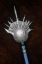

# Galvanic Greatmace

<!-- Généré depuis docs/data/owd-boutique.json ; modifier la Boutique. -->

{ .equipment-portrait }

**Catégorie :** Grands marteaux  
**Famille :** Galvanic  
**Origine :** Outward

A greathammer crafted in the Galvanic style.

| Caractéristique | Valeur |
| --- | --- |
| Poids (kg) | 4 |
| Volume (L) | 10 |
| Taille | Moyenne |
| Mains | 2 |
| Achat (argent) | 1125 |
| Vente (argent) | 337.5 |
| Attaque | 15 |
| Touches | 1 |
| Dégâts de base | 155 |
| Parade | 11 |
| Réduction de base | 25 |
| Modificateur de dégâts 1 | FOR |
| Modificateur de dégâts 2 | FOR |
| Modificateur de dégâts 3 | FOR |
| Modificateur de réduction 1 | FOR |
| Modificateur de réduction 2 | FOR |
| Physique (%) | 100 |
| Feu (%) | 0 |
| Froid (%) | 0 |
| Éclair (%) | 0 |
| Décomposition (%) | 0 |
| Éthéré (%) | 0 |
| FOR requise | 30 |
| Propriété — gestion manuelle | Pain / Buildup 45% |

[Retour au catalogue](../equipement.md)
