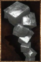

# Pyrite Greathammer

<!-- illustration -->
{ .equipment-portrait }
<!-- /illustration -->

**Catégorie :** Grands marteaux  
**Famille :** Hors set  
**Origine :** Outward

Inflicts Confusion on enemies.

| Caractéristique | Valeur |
| --- | --- |
| Poids (kg) | 6 |
| Volume (L) | 17 |
| Taille | Moyenne |
| Achat (argent) | 1125 |
| Vente (argent) | 338 |
| Attaque | 15 |
| Touches | 1 |
| Dégâts de base | 115 |
| Modificateur de dégâts 1 | FOR |
| Modificateur de dégâts 2 | FOR |
| Modificateur de dégâts 3 | FOR |
| Parade | 11 |
| Réduction de base | 25 |
| Modificateur de réduction 1 | FOR |
| Modificateur de réduction 2 | FOR |
| DEX requise | — |
| FOR requise | 30 |
| Physique (%) | 75,0 |
| Feu (%) | 25,0 |
| Froid (%) | 0,0 |
| Foudre (%) | 0,0 |
| Décomposition (%) | 0,0 |
| Éthéré (%) | 0,0 |

## Propriétés

Confusion / Accumulation 100%

[Retour au catalogue](../equipement.md)
