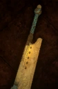

# Smoke Great Sabre

<!-- illustration -->
{ .equipment-portrait }
<!-- /illustration -->

**Catégorie :** Grands sabres  
**Famille :** Smoke  
**Origine :** Outward

Inflicts Blaze on Burning foes.

| Caractéristique | Valeur |
| --- | --- |
| Poids (kg) | 2,5 |
| Volume (L) | 3 |
| Taille | Moyenne |
| Achat (argent) | 1125 |
| Vente (argent) | 337,5 |
| Attaque | 12 |
| Touches | 3 |
| Dégâts de base | 115 |
| Modificateur de dégâts 1 | DEX |
| Modificateur de dégâts 2 | DEX |
| Modificateur de dégâts 3 | FOR |
| Parade | 8 |
| Réduction de base | 15 |
| Modificateur de réduction 1 | DEX |
| Modificateur de réduction 2 | DEX |
| DEX requise | 20 |
| FOR requise | 10 |
| Physique (%) | 100,0 |
| Feu (%) | 0,0 |
| Froid (%) | 0,0 |
| Foudre (%) | 0,0 |
| Décomposition (%) | 0,0 |
| Éthéré (%) | 0,0 |

## Propriétés

Blaze / Accumulation 33%

[Retour au catalogue](../equipement.md)
