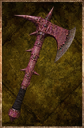

# Assassin Axe

<!-- Généré depuis docs/data/owd-boutique.json ; modifier la Boutique. -->

{ .equipment-portrait }

**Catégorie :** Haches 1 main  
**Famille :** Assassin  
**Origine :** Homebrew

An axe crafted in the Assassin style.

| Caractéristique | Valeur |
| --- | --- |
| Poids (kg) | 0.9 |
| Volume (L) | 2 |
| Taille | Petite |
| Mains | 1 |
| Achat (argent) | 200 |
| Vente (argent) | 60 |
| Attaque | 10 |
| Touches | 2 |
| Dégâts de base | 45 |
| Parade | 6 |
| Réduction de base | 10 |
| Modificateur de dégâts 1 | FOR |
| Modificateur de dégâts 2 | DEX |
| Modificateur de réduction 1 | FOR |
| Physique (%) | 75 |
| Feu (%) | 0 |
| Froid (%) | 0 |
| Éclair (%) | 0 |
| Décomposition (%) | 25 |
| Éthéré (%) | 0 |
| FOR requise | 10 |
| DEX requise | 10 |
| Propriété — gestion manuelle | Slow Down / Buildup 45% |
| Propriété — gestion manuelle | Bleeding / Buildup 33% |

[Retour au catalogue](../equipement.md)
