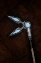

# Chalcedony Axe

<!-- illustration -->
{ .equipment-portrait }
<!-- /illustration -->

**Catégorie :** Haches 1 main  
**Famille :** Chalcedony  
**Origine :** Outward

Inflicts Slow Down.

| Caractéristique | Valeur |
| --- | --- |
| Poids (kg) | 4 |
| Volume (L) | 2 |
| Taille | Petite |
| Achat (argent) | 500 |
| Vente (argent) | 150 |
| Attaque | 10 |
| Touches | 2 |
| Dégâts de base | 65 |
| Modificateur de dégâts 1 | FOR |
| Modificateur de dégâts 2 | DEX |
| Parade | 6 |
| Réduction de base | 10 |
| Modificateur de réduction 1 | FOR |
| DEX requise | 10 |
| FOR requise | 10 |
| Physique (%) | 50,0 |
| Feu (%) | 0,0 |
| Froid (%) | 50,0 |
| Foudre (%) | 0,0 |
| Décomposition (%) | 0,0 |
| Éthéré (%) | 0,0 |

## Propriétés

Slow Down / Accumulation 33%

[Retour au catalogue](../equipement.md)
