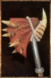

# Tuanosaur Axe

<!-- illustration -->
{ .equipment-portrait }
<!-- /illustration -->

**Catégorie :** Haches 1 main  
**Famille :** Tuanosaur  
**Origine :** Outward

Inflicts Extreme Bleeding on enemies.

| Caractéristique | Valeur |
| --- | --- |
| Poids (kg) | 1 |
| Volume (L) | 2 |
| Taille | Petite |
| Achat (argent) | 450 |
| Vente (argent) | 135 |
| Attaque | 11 |
| Touches | 2 |
| Dégâts de base | 75 |
| Modificateur de dégâts 1 | FOR |
| Modificateur de dégâts 2 | DEX |
| Parade | 7 |
| Réduction de base | 10 |
| Modificateur de réduction 1 | FOR |
| DEX requise | 10 |
| FOR requise | 10 |
| Physique (%) | 100,0 |
| Feu (%) | 0,0 |
| Froid (%) | 0,0 |
| Foudre (%) | 0,0 |
| Décomposition (%) | 0,0 |
| Éthéré (%) | 0,0 |

## Propriétés

Extreme Bleeding / Accumulation 45%

[Retour au catalogue](../equipement.md)
