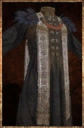

# Arcane Robe

<!-- Généré depuis docs/data/owd-boutique.json ; modifier la Boutique. -->

{ .equipment-portrait }

**Catégorie :** Robes  
**Famille :** Arcane Set  
**Origine :** Outward

A full-length outfit covering both the upper and lower body.

| Caractéristique | Valeur |
| --- | --- |
| Poids (kg) | 2.5 |
| Volume (L) | 7.5 |
| Taille | Très petite |
| Mains | 1 |
| Achat (argent) | 174 |
| Vente (argent) | 54 |
| Protection contre le froid | 6 |
| Protection contre la chaleur | 0 |
| Poches (L) | 0 |
| Protection Physique | 1 |
| Résistance Physique (%) | 10 |
| Résistance Feu (%) | 14 |
| Résistance Froid (%) | 14 |
| Résistance Éclair (%) | 14 |
| Résistance Décomposition (%) | 14 |
| Résistance Éthéré (%) | 14 |
| Bonus Froid (%) | 7 |
| Coût PM (%) | -16 |

[Retour au catalogue](../equipement.md)
