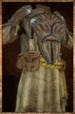

# Chitin Desert Tunic

<!-- Généré depuis docs/data/owd-boutique.json ; modifier la Boutique. -->

{ .equipment-portrait }

**Catégorie :** Robes  
**Famille :**   
**Origine :** Outward

Chitin Desert Tunic is a craftable type of Body Armor in Outward.

| Caractéristique | Valeur |
| --- | --- |
| Poids (kg) | 7.5 |
| Volume (L) | 25 |
| Taille | Petite |
| Mains | 1 |
| Achat (argent) | 91 |
| Vente (argent) | 30 |
| Protection contre le froid | 0 |
| Protection contre la chaleur | 19 |
| Poches (L) | 0 |
| Résistance Physique (%) | 11 |

[Retour au catalogue](../equipement.md)
