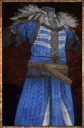

# Clansage Robe

<!-- Généré depuis docs/data/owd-boutique.json ; modifier la Boutique. -->

{ .equipment-portrait }

**Catégorie :** Robes  
**Famille :**   
**Origine :** Outward

Clansage Robe is a type of Armor in Outward.

| Caractéristique | Valeur |
| --- | --- |
| Poids (kg) | 3.5 |
| Volume (L) | 8 |
| Taille | Très petite |
| Mains | 1 |
| Achat (argent) | 140 |
| Vente (argent) | 47 |
| Protection contre le froid | 14 |
| Protection contre la chaleur | 0 |
| Poches (L) | 0 |
| Résistance Physique (%) | 8 |
| Résistance Froid (%) | 16 |
| Coût PM (%) | -16 |

[Retour au catalogue](../equipement.md)
