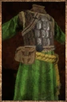

# Elite Desert Tunic

<!-- Généré depuis docs/data/owd-boutique.json ; modifier la Boutique. -->

{ .equipment-portrait }

**Catégorie :** Robes  
**Famille :** Elite Desert Set  
**Origine :** Outward

| Caractéristique | Valeur |
| --- | --- |
| Poids (kg) | 5.5 |
| Volume (L) | 6.5 |
| Taille | Très petite |
| Mains | 1 |
| Achat (argent) | 458 |
| Vente (argent) | 150 |
| Protection contre le froid | 0 |
| Protection contre la chaleur | 15 |
| Poches (L) | 0 |
| Protection Physique | 3 |
| Résistance Physique (%) | 21 |
| Coût PM (%) | 5 |
| Coût PE (%) | -14 |

[Retour au catalogue](../equipement.md)
