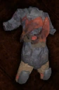

# Militia Armor

<!-- Généré depuis docs/data/owd-boutique.json ; modifier la Boutique. -->

{ .equipment-portrait }

**Catégorie :** Haut  
**Famille :** Militia Set  
**Origine :** Outward

Worker's clothes, reinforced for battle. Completely resists Burning.

| Caractéristique | Valeur |
| --- | --- |
| Poids (kg) | 7 |
| Volume (L) | 17 |
| Taille | Petite |
| Mains | 1 |
| Achat (argent) | 329 |
| Vente (argent) | 99 |
| Protection contre le froid | 0 |
| Protection contre la chaleur | 8 |
| Poches (L) | 0 |
| Protection Physique | 2 |
| Résistance Physique (%) | 14 |
| Coût PM (%) | 3 |
| Coût PE (%) | 2 |
| Déplacement (%) | -2 |
| Propriété — gestion manuelle | Prevents Burning |

[Retour au catalogue](../equipement.md)
