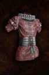

# Noble Clothes

<!-- Généré depuis docs/data/owd-boutique.json ; modifier la Boutique. -->

{ .equipment-portrait }

**Catégorie :** Haut  
**Famille :** Noble Set  
**Origine :** Outward

| Caractéristique | Valeur |
| --- | --- |
| Poids (kg) | 2.5 |
| Volume (L) | 4 |
| Taille | Très petite |
| Mains | 1 |
| Achat (argent) | 258 |
| Vente (argent) | 78 |
| Protection contre le froid | 0 |
| Protection contre la chaleur | 5 |
| Poches (L) | 0 |
| Résistance Physique (%) | 6 |
| Résistance Feu (%) | 13 |
| Résistance Décomposition (%) | 13 |
| Résistance Éthéré (%) | 15 |
| Coût PM (%) | -7 |
| Déplacement (%) | 5 |

[Retour au catalogue](../equipement.md)
