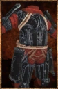

# Runic Armor

<!-- Généré depuis docs/data/owd-boutique.json ; modifier la Boutique. -->

{ .equipment-portrait }

**Catégorie :** Haut  
**Famille :** Runic Set  
**Origine :** Outward

A garment covering the upper body.

| Caractéristique | Valeur |
| --- | --- |
| Poids (kg) | 11 |
| Volume (L) | 27 |
| Taille | Petite |
| Mains | 1 |
| Achat (argent) | 400 |
| Vente (argent) | 131 |
| Protection contre le froid | 0 |
| Protection contre la chaleur | -4 |
| Poches (L) | 0 |
| Protection Physique | 2 |
| Résistance Physique (%) | 13 |
| Protection Feu | 2 |
| Protection Froid | 2 |
| Protection Éclair | 2 |
| Protection Décomposition | 2 |
| Protection Éthéré | 2 |
| Bonus Éclair (%) | 4 |
| Bonus Éthéré (%) | 4 |
| Coût PM (%) | -5 |
| Coût PE (%) | 9 |
| Déplacement (%) | -4 |

[Retour au catalogue](../equipement.md)
