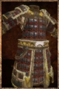

# Silver Armor

<!-- Généré depuis docs/data/owd-boutique.json ; modifier la Boutique. -->

{ .equipment-portrait }

**Catégorie :** Haut  
**Famille :** Silver Set  
**Origine :** Outward

| Caractéristique | Valeur |
| --- | --- |
| Poids (kg) | 7 |
| Volume (L) | 20 |
| Taille | Petite |
| Mains | 1 |
| Achat (argent) | 264 |
| Vente (argent) | 86 |
| Protection contre le froid | 0 |
| Protection contre la chaleur | 0 |
| Poches (L) | 0 |
| Protection Physique | 2 |
| Résistance Physique (%) | 14 |
| Protection Feu | 2 |
| Protection Froid | 2 |
| Protection Éclair | 2 |
| Protection Décomposition | 2 |
| Résistance Décomposition (%) | 18 |
| Protection Éthéré | 2 |
| Coût PM (%) | 5 |
| Coût PE (%) | 2 |
| Déplacement (%) | -2 |

[Retour au catalogue](../equipement.md)
