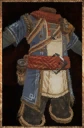

# Trader Garb

<!-- Généré depuis docs/data/owd-boutique.json ; modifier la Boutique. -->

{ .equipment-portrait }

**Catégorie :** Haut  
**Famille :** Trader Set  
**Origine :** Outward

A garment covering the upper body.

| Caractéristique | Valeur |
| --- | --- |
| Poids (kg) | 2.5 |
| Volume (L) | 3 |
| Taille | Très petite |
| Mains | 1 |
| Achat (argent) | 23 |
| Vente (argent) | 7 |
| Protection contre le froid | 3 |
| Protection contre la chaleur | 1 |
| Poches (L) | 8 |
| Résistance Physique (%) | 5 |

[Retour au catalogue](../equipement.md)
