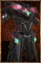

# Tsar Armor

<!-- Généré depuis docs/data/owd-boutique.json ; modifier la Boutique. -->

{ .equipment-portrait }

**Catégorie :** Haut  
**Famille :** Tsar Set  
**Origine :** Outward

A garment covering the upper body.

| Caractéristique | Valeur |
| --- | --- |
| Poids (kg) | 14 |
| Volume (L) | 35 |
| Taille | Petite |
| Mains | 1 |
| Achat (argent) | 600 |
| Vente (argent) | 195 |
| Protection contre le froid | 0 |
| Protection contre la chaleur | 7 |
| Poches (L) | 0 |
| Protection Physique | 4 |
| Résistance Physique (%) | 21 |
| Résistance Feu (%) | 24 |
| Coût PM (%) | 5 |
| Coût PE (%) | 4 |
| Déplacement (%) | -9 |

[Retour au catalogue](../equipement.md)
