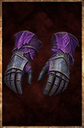

# Manawall Gauntlets

<!-- Généré depuis docs/data/owd-boutique.json ; modifier la Boutique. -->

{ .equipment-portrait }

**Catégorie :** Mains  
**Famille :** Manawall Set  
**Origine :** Homebrew

| Caractéristique | Valeur |
| --- | --- |
| Poids (kg) | 0.4 |
| Volume (L) | 1.5 |
| Taille | Minuscule |
| Mains | 1 |
| Achat (argent) | 160 |
| Vente (argent) | 48.2 |
| Protection contre le froid | 0 |
| Protection contre la chaleur | 2 |
| Poches (L) | 0 |
| Protection Physique | 1 |
| Résistance Physique (%) | 4 |
| Protection Feu | 1 |
| Protection Froid | 1 |
| Protection Éclair | 1 |
| Protection Décomposition | 1 |
| Protection Éthéré | 1 |
| Bonus Éthéré (%) | 4 |
| Déplacement (%) | 2 |

[Retour au catalogue](../equipement.md)
