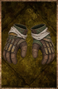

# Pathfinder Gloves

<!-- Généré depuis docs/data/owd-boutique.json ; modifier la Boutique. -->

{ .equipment-portrait }

**Catégorie :** Mains  
**Famille :** Pathfinder Set  
**Origine :** Homebrew

Hand protection.

| Caractéristique | Valeur |
| --- | --- |
| Poids (kg) | 1 |
| Volume (L) | 0.8 |
| Taille | Minuscule |
| Mains | 1 |
| Achat (argent) | 150 |
| Vente (argent) | 46 |
| Protection contre le froid | 3 |
| Protection contre la chaleur | 1 |
| Poches (L) | 0 |
| Résistance Physique (%) | 6 |
| Résistance Décomposition (%) | 6 |
| Coût PM (%) | 2 |
| Coût PE (%) | 1 |
| Déplacement (%) | -1 |

[Retour au catalogue](../equipement.md)
