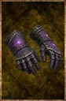

# Tenebrous Gloves

<!-- Généré depuis docs/data/owd-boutique.json ; modifier la Boutique. -->

{ .equipment-portrait }

**Catégorie :** Mains  
**Famille :** Tenebrous Set  
**Origine :** Homebrew

| Caractéristique | Valeur |
| --- | --- |
| Poids (kg) | 0.7 |
| Volume (L) | 1.5 |
| Taille | Minuscule |
| Mains | 1 |
| Achat (argent) | 135 |
| Vente (argent) | 43 |
| Protection contre le froid | 2 |
| Protection contre la chaleur | 0 |
| Poches (L) | 0 |
| Résistance Physique (%) | 5 |
| Résistance Feu (%) | 4 |
| Résistance Froid (%) | 4 |
| Résistance Éclair (%) | 4 |
| Bonus Décomposition (%) | 3 |
| Bonus Éthéré (%) | 2 |
| Coût PM (%) | -4 |
| Résistance à la corruption (%) | 2 |

[Retour au catalogue](../equipement.md)
