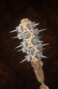

# Calygrey Mace

<!-- illustration -->
{ .equipment-portrait }
<!-- /illustration -->

**Catégorie :** Masses 1 main  
**Famille :** Calygrey  
**Origine :** Outward

| Caractéristique | Valeur |
| --- | --- |
| Poids (kg) | 3 |
| Volume (L) | 3 |
| Taille | Petite |
| Achat (argent) | 200 |
| Vente (argent) | 60 |
| Attaque | 14 |
| Touches | 1 |
| Dégâts de base | 65 |
| Modificateur de dégâts 1 | FOR |
| Modificateur de dégâts 2 | FOR |
| Parade | 11 |
| Réduction de base | 15 |
| Modificateur de réduction 1 | FOR |
| DEX requise | — |
| FOR requise | 20 |
| Physique (%) | 70,0 |
| Feu (%) | 0,0 |
| Froid (%) | 0,0 |
| Foudre (%) | 30,0 |
| Décomposition (%) | 0,0 |
| Éthéré (%) | 0,0 |

[Retour au catalogue](../equipement.md)
