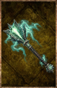

# Ghost Mace

<!-- illustration -->
{ .equipment-portrait }
<!-- /illustration -->

**Catégorie :** Masses 1 main  
**Famille :** Ghost  
**Origine :** Créé pour le JDR

| Caractéristique | Valeur |
| --- | --- |
| Poids (kg) | 2 |
| Volume (L) | 4 |
| Taille | Petite |
| Achat (argent) | 2500 |
| Vente (argent) | 750 |
| Attaque | 8 |
| Touches | 1 |
| Dégâts de base | 100 |
| Modificateur de dégâts 1 | FOR |
| Modificateur de dégâts 2 | FOR |
| Parade | 5 |
| Réduction de base | 15 |
| Modificateur de réduction 1 | FOR |
| DEX requise | 0 |
| FOR requise | 20 |
| Physique (%) | 50,0 |
| Feu (%) | 0,0 |
| Froid (%) | 0,0 |
| Foudre (%) | 0,0 |
| Décomposition (%) | 0,0 |
| Éthéré (%) | 50,0 |

## Propriétés

Aetherbomb / Accumulation 40%
-15% Physical resistance

[Retour au catalogue](../equipement.md)
