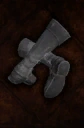

# Krypteia Boots

<!-- Généré depuis docs/data/owd-boutique.json ; modifier la Boutique. -->

{ .equipment-portrait }

**Catégorie :** Pieds  
**Famille :** Krypteia Set  
**Origine :** Outward

Noise-silencing boots worn by a secret order of scholars turned assassins. Fully prevents Blaze.

| Caractéristique | Valeur |
| --- | --- |
| Poids (kg) | 4 |
| Volume (L) | 3 |
| Taille | Très petite |
| Mains | 1 |
| Achat (argent) | 203 |
| Vente (argent) | 60.9 |
| Protection contre le froid | 0 |
| Protection contre la chaleur | 0 |
| Poches (L) | 0 |
| Résistance Physique (%) | 8 |
| Résistance Feu (%) | 3 |
| Résistance Éthéré (%) | 3 |
| Bonus Éclair (%) | 4 |
| Propriété — gestion manuelle | Prevents Blaze |

[Retour au catalogue](../equipement.md)
