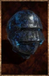

# Blue Sand Helm

<!-- illustration -->
{ .equipment-portrait }
<!-- /illustration -->

**Catégorie :** Tête  
**Famille :** Blue Sand Set  
**Origine :** Outward

| Caractéristique | Valeur |
| --- | --- |
| Poids (kg) | 5 |
| Volume (L) | 10 |
| Construction | Rigide |
| Achat (argent) | 160 |
| Vente (argent) | 51 |
| Protection | 1 |
| Résistance physique (%) | 6 |
| Résistance feu (%) | 2 |
| Résistance froid (%) | 2 |
| Résistance foudre (%) | 2 |
| Résistance décomposition (%) | 2 |
| Résistance éthéré (%) | 2 |
| Protection contre le froid | 0 |
| Protection contre la chaleur | -2 |
| Bonus physique (%) | 0 |
| Bonus feu (%) | 0 |
| Bonus froid (%) | 0 |
| Bonus foudre (%) | 0 |
| Bonus décomposition (%) | 0 |
| Bonus éthéré (%) | 0 |
| Coût de mana (%) | 1 |
| Coût d’endurance (%) | 2 |
| Vitesse (%) | -2 |
| Barrière | 0 |
| Réduction des délais (%) | 0 |
| Résistance à la corruption (%) | 0 |
| Résistance aux statuts (%) | 0 |
| Poches supplémentaires (kg) | 0 |

[Retour au catalogue](../equipement.md)
