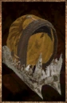

# Elite Hood

<!-- Généré depuis docs/data/owd-boutique.json ; modifier la Boutique. -->

{ .equipment-portrait }

**Catégorie :** Tête  
**Famille :** Elite Set  
**Origine :** Outward

Protective headwear.

| Caractéristique | Valeur |
| --- | --- |
| Poids (kg) | 3 |
| Volume (L) | 1.5 |
| Taille | Minuscule |
| Mains | 1 |
| Achat (argent) | 192 |
| Vente (argent) | 64 |
| Protection contre le froid | 0 |
| Protection contre la chaleur | 6 |
| Poches (L) | 0 |
| Résistance Physique (%) | 8 |
| Résistance Décomposition (%) | 30 |
| Coût PE (%) | -12 |
| Déplacement (%) | -1 |

[Retour au catalogue](../equipement.md)
