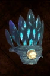

# Ergagr'Uk!

<!-- Généré depuis docs/data/owd-boutique.json ; modifier la Boutique. -->

{ .equipment-portrait }

**Catégorie :** Tête  
**Famille :**   
**Origine :** Outward

| Caractéristique | Valeur |
| --- | --- |
| Poids (kg) | 1 |
| Volume (L) | 7 |
| Taille | Très petite |
| Mains | 1 |
| Achat (argent) | 20 |
| Vente (argent) | 6 |
| Protection contre le froid | 0 |
| Protection contre la chaleur | 0 |
| Poches (L) | 0 |
| Bonus Éthéré (%) | 50 |
| Coût PM (%) | -50 |
| Propriété — gestion manuelle | Only usable by a Troglodyte. Changes the wearer into a Mana Troglodyte. Regenerates 0.1 MP per second. |

[Retour au catalogue](../equipement.md)
