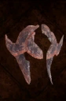

# GorkKrog!

<!-- Généré depuis docs/data/owd-boutique.json ; modifier la Boutique. -->

{ .equipment-portrait }

**Catégorie :** Tête  
**Famille :**   
**Origine :** Outward

GorkKrog! is a type of Equipment in Outward, which can only be used by Troglodyte players.

| Caractéristique | Valeur |
| --- | --- |
| Poids (kg) | 1 |
| Volume (L) | 4 |
| Taille | Très petite |
| Mains | 1 |
| Achat (argent) | 20 |
| Vente (argent) | 6 |
| Protection contre le froid | 0 |
| Protection contre la chaleur | 0 |
| Poches (L) | 0 |
| Protection Physique | 10 |
| Résistance Physique (%) | 50 |
| Bonus Physique (%) | 25 |
| Propriété — gestion manuelle | Only usable by a Troglodyte. Changes the wearer into an armored Troglodyte. |

[Retour au catalogue](../equipement.md)
