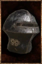

# Plate Helm

<!-- Généré depuis docs/data/owd-boutique.json ; modifier la Boutique. -->

{ .equipment-portrait }

**Catégorie :** Tête  
**Famille :** Plate Set  
**Origine :** Outward

| Caractéristique | Valeur |
| --- | --- |
| Poids (kg) | 8 |
| Volume (L) | 9 |
| Taille | Très petite |
| Mains | 1 |
| Achat (argent) | 100 |
| Vente (argent) | 32 |
| Protection contre le froid | 0 |
| Protection contre la chaleur | -2 |
| Poches (L) | 0 |
| Protection Physique | 1 |
| Résistance Physique (%) | 6 |
| Coût PM (%) | 7 |
| Coût PE (%) | 2 |
| Déplacement (%) | -2 |

[Retour au catalogue](../equipement.md)
